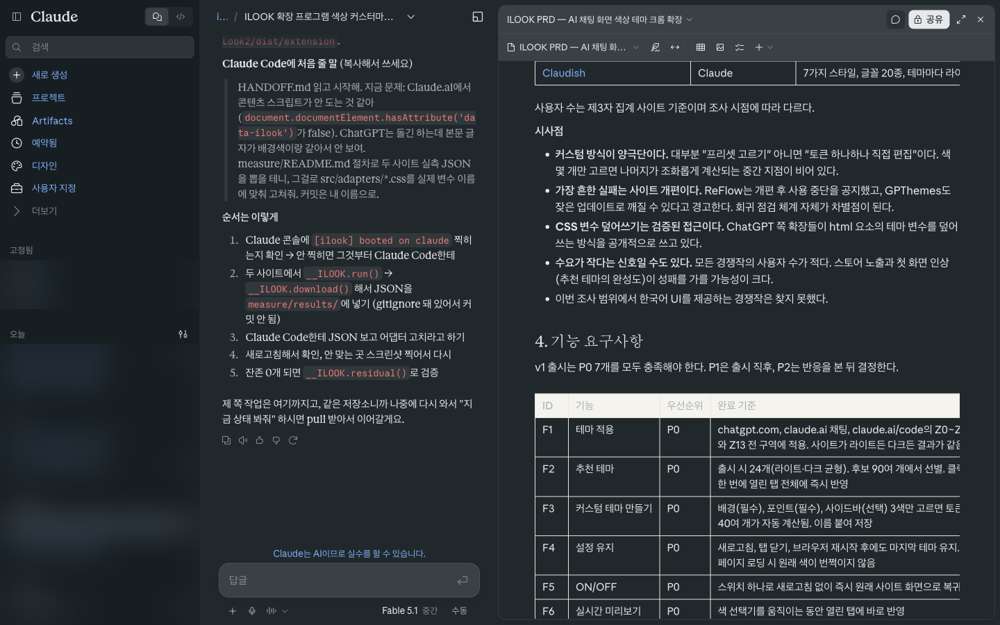
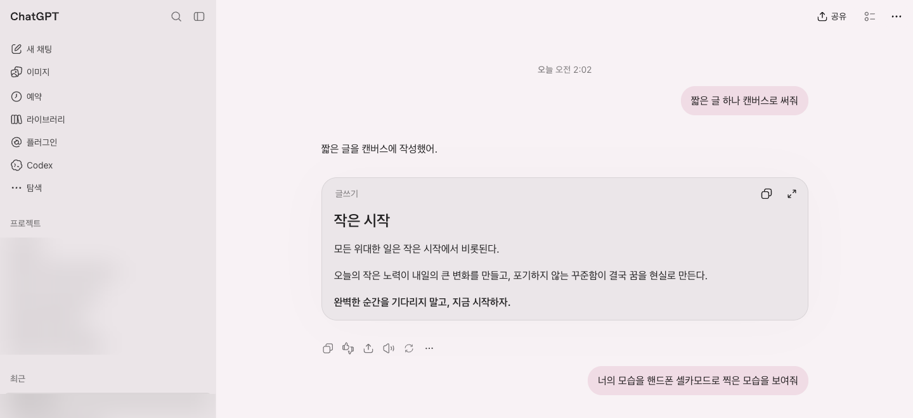
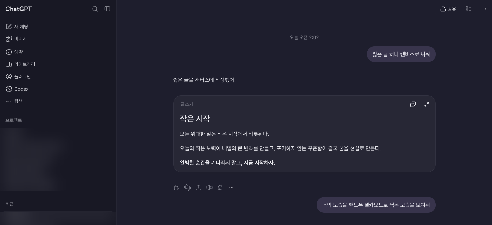
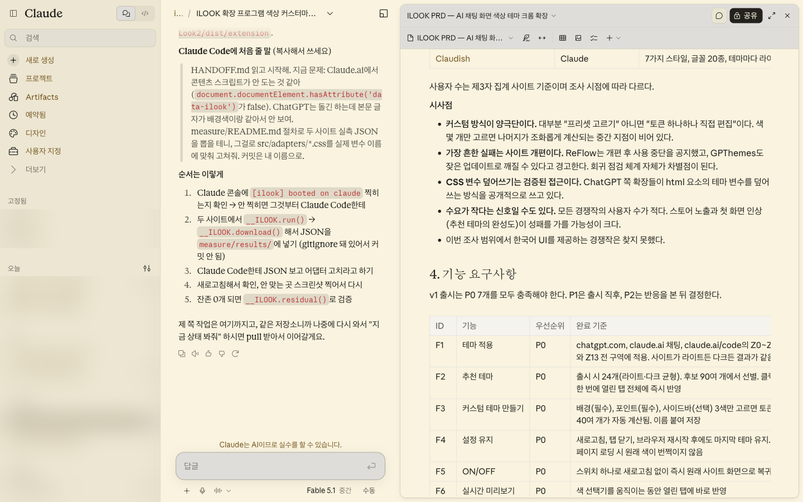
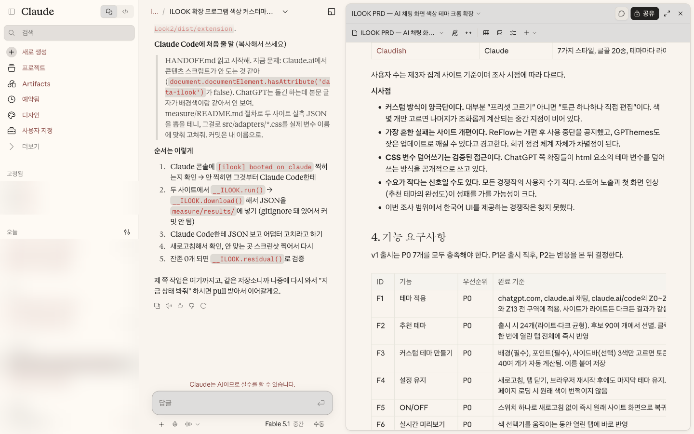
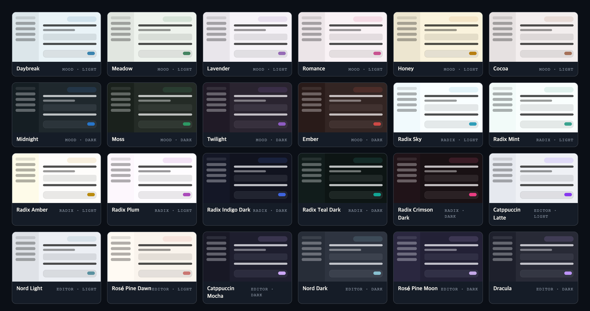
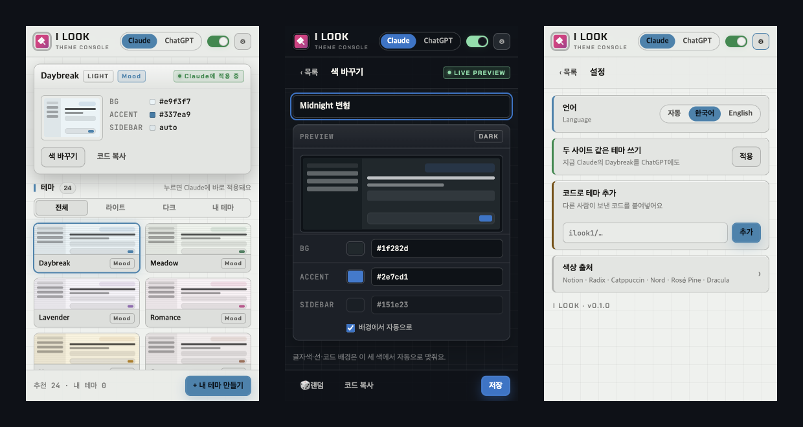

<p align="center">
  
</p>

<h1 align="center">I Look</h1>

<p align="center"><strong>ChatGPT와 Claude를 내 색으로.</strong><br>
색 두세 개만 고르면 화면 전체가 바뀌고, 글자는 언제나 읽힙니다.</p>

<p align="center">
  추천 테마 24개 · 사이트별 다른 테마 · 실시간 미리보기 · 테마 공유 코드 · 한국어 / English<br>
  네트워크 요청 0건 · 대화 내용을 읽지 않음
</p>

**I Look이 뭔가요?**
ChatGPT, Claude, Claude Code 웹 화면의 색을 바꿔 주는 크롬 확장 프로그램입니다. 추천 테마를 고르거나 배경·포인트 색 두세 개만 정하면, 사이드바부터 입력창, 코드 블록, 캔버스, 문서 패널까지 화면 전체가 그 색으로 바뀝니다. 글자색은 엔진이 배경에 맞춰 계산하므로 어떤 색을 골라도 읽힙니다.

**왜 만들었나요?**
ChatGPT와 Claude는 하루에 몇 시간씩 보는 화면인데, 고를 수 있는 건 흰색과 검은색뿐이었습니다. 기존 테마 도구는 프리셋 몇 개만 주거나, 색 수십 개를 직접 채우게 하면서 "검은 배경에 검은 글자" 같은 사고를 막아 주지 않았고, 사이트가 개편될 때마다 깨졌습니다. 색 몇 개만 고르면 나머지를 알아서 맞춰 주는 도구가 있었으면 해서 직접 만들었습니다.

<p align="center">
  
  <sub>Claude · Midnight</sub>
</p>

---

## 하루에 몇 시간씩 보는 화면인데, 왜 흰색 아니면 검은색일까요

눈이 편한 크림색, 집중이 잘 되는 짙은 남색, 좋아하는 에디터 테마… 그런 선택지는 없었습니다.
I Look은 그 선택지를 만듭니다. 확장 프로그램 하나를 켜면 두 사이트가 통째로 내 색이 됩니다.

<table>
  <tr>
    <td width="50%"><br><sub>ChatGPT · Romance</sub></td>
    <td width="50%"><br><sub>ChatGPT · Catppuccin Mocha</sub></td>
  </tr>
  <tr>
    <td width="50%"><br><sub>Claude · Honey</sub></td>
    <td width="50%"><br><sub>Claude · Rosé Pine Dawn</sub></td>
  </tr>
</table>

---

## 색 세 개면 끝납니다

다른 테마 도구는 둘 중 하나입니다. 프리셋 몇 개 중에 고르거나, 색 수십 개를 직접 채우거나.
후자는 "검은 배경에 검은 글자" 같은 사고를 막아 주지 않습니다.

I Look은 **배경, 포인트, 사이드바(선택)** 세 가지 색만 받습니다. 나머지는 색 엔진이 계산합니다.

- **49개 토큰 자동 계산.** 본문 글자, 흐린 글자, 링크, 선, 카드, 메뉴, hover, 말풍선, 코드 블록, 코드 하이라이트까지. OKLCH 색공간에서 계산하기 때문에 어떤 색상에서도 밝기 단계가 고르게 나옵니다.
- **읽히는 글자를 보장.** 글자색은 사용자가 고르지 않습니다. 글자가 놓이는 모든 면(배경, 입력창, 메뉴, 사이드바, 선택된 항목) 위에서 대비 기준을 넘길 때까지 엔진이 조정합니다. 형광 핑크 배경을 고르더라도 글이 보입니다.
- **라이트와 다크를 자동 판별.** 배경이 밝으면 사이트 전체가 라이트 모드로, 어두우면 다크 모드로 맞춰집니다. 사이트 자체 설정을 건드릴 필요가 없습니다.

---

## 추천 테마 24개

눈이 편한 **Mood** 시리즈 10개, 선명한 **Radix** 시리즈 7개, 에디터에서 익숙한 **Editor** 시리즈 7개. 라이트와 다크가 고르게 들어 있습니다.

<p align="center">
  
</p>

| 시리즈 | 테마 |
| --- | --- |
| Mood | Daybreak · Meadow · Lavender · Romance · Honey · Cocoa · Midnight · Moss · Twilight · Ember |
| Radix | Sky · Mint · Amber · Plum · Indigo Dark · Teal Dark · Crimson Dark |
| Editor | Catppuccin Latte · Catppuccin Mocha · Nord Light · Nord Dark · Rosé Pine Dawn · Rosé Pine Moon · Dracula |

---

## 팝업은 테마 콘솔입니다

게임 아이템창과 개발자 콘솔을 섞은 디자인. 지금 적용된 테마의 색 값이 한눈에 보이고, 누르면 바로 바뀝니다.

<p align="center">
  
  <sub>테마 목록 · 색 바꾸기(실시간 미리보기) · 설정</sub>
</p>

- **사이트별로 다른 테마.** 위쪽 탭에서 Claude와 ChatGPT를 오가며 각각 다른 테마를 둘 수 있습니다. 같게 쓰고 싶으면 설정에서 한 번에 복사합니다.
- **실시간 미리보기.** 색을 고르는 동안 열려 있는 탭이 즉시 따라옵니다. 저장하지 않고 닫으면 원래 테마로 돌아갑니다.
- **🎲 랜덤.** 어울리는 배경과 포인트 조합을 뽑아 줍니다. 마음에 들면 저장하세요.
- **테마 공유 코드.** 내 테마를 `ilook1/…` 한 줄 코드로 복사해 친구에게 보내면, 상대는 설정에 붙여넣기만 하면 됩니다.
- **한국어 / English.** 브라우저 언어를 따라가고, 설정에서 바꿀 수 있습니다.
- **ON/OFF 스위치.** 끄면 새로고침 없이 사이트 원래 색으로 돌아갑니다.

---

## 구석까지 칠합니다

두 사이트의 실제 화면을 요소 단위로 측정해서, 남은 색이 0개가 될 때까지 맞췄습니다.

| 구역 | 적용 |
| --- | --- |
| 채팅 | 말풍선, 본문, 마크다운, 표, 인용, 입력창, 하단 바 |
| 사이드바 | 배경, 항목, hover, 선택, 접힌 상태, 단축키 표시 |
| 코드 | 코드 블록 배경과 **구문 하이라이트 색**까지 테마에 맞춰 다시 계산 |
| ChatGPT | 캔버스 카드, 이미지 답변, Codex, 출처 칩, 설정·공유 모달, 메뉴 |
| Claude | 아티팩트·문서 패널(세 겹 iframe 안까지), 프로젝트, Claude Code 세션 |
| 모드 | 사이트의 라이트·다크 전환, 새 ChatGPT 셸과 옛 셸 모두 |

**번쩍임이 없습니다.** 계산된 색을 사이트에 캐시해 두고 첫 화면이 그려지기 전에 적용합니다. 새로고침해도 흰 화면이 스치지 않습니다.

---

## 아무것도 보내지 않습니다

- 네트워크 요청 **0건**. 모든 색은 기기 안에서 계산합니다.
- 대화 내용을 읽지 않습니다. 하는 일은 CSS 변수를 바꿔 끼우는 것뿐입니다.
- 권한은 설정 저장(`storage`)과 chatgpt.com, claude.ai 접근뿐입니다. 방문 기록 권한은 없고, 다른 사이트에는 아무것도 하지 않습니다.

---

## 설치

크롬 웹 스토어 등록을 준비 중입니다. 지금은 직접 빌드해서 쓸 수 있습니다.

```
git clone https://github.com/P2P-J/I-Look2.git
cd I-Look2
npm install
npm run build
```

1. 크롬에서 `chrome://extensions` 열기
2. 오른쪽 위 **개발자 모드** 켜기
3. **압축해제된 확장 프로그램을 로드합니다** → `dist/extension` 폴더 선택
4. chatgpt.com 또는 claude.ai를 새로고침하고 툴바의 I Look 아이콘을 누르세요

```
npm test          색 엔진·대비·저장·공유 코드 테스트
npm run preview   dist/preview.html — 테마 토큰 미리보기
```

---

## 개발

```
src/engine/     색 엔진 — 시드 3색 → 토큰 49개, 순수 함수
src/themes/     추천 테마 24개
src/adapters/   사이트별 CSS (chatgpt.css, claude.css, syntax.css)
src/content/    콘텐츠 스크립트 — 토큰 주입, 캐시, 미리보기
src/popup/      팝업 UI
src/_locales/   ko · en
test/           테스트
```

구조의 핵심은 세 층의 분리입니다. **구역**(화면 위치)은 **토큰**(의미)만 참조하고, **테마**는 시드 3색만 가집니다. 사이트가 개편되면 어댑터 CSS 한 파일만 손보면 되고, 테마 하나를 만드는 비용은 언제나 색 3개입니다.

자세한 내부 구조와 검증 방법은 [HANDOFF.md](HANDOFF.md)에 있습니다.

---

## 출처와 라이선스

| 시리즈 | 출처 | 라이선스 |
| --- | --- | --- |
| Mood | Notion 앱 색상 체계를 참고 ([Matthias Frank의 정리](https://matthiasfrank.de/en/notion-colors/)) | Notion Labs와 무관 |
| Radix | [Radix Colors](https://github.com/radix-ui/colors) | MIT |
| Editor | [Catppuccin](https://github.com/catppuccin/catppuccin) · [Nord](https://www.nordtheme.com/) · [Rosé Pine](https://rosepinetheme.com/) · [Dracula](https://draculatheme.com/) | MIT |

팝업 글꼴 [Chakra Petch](https://fonts.google.com/specimen/Chakra+Petch), [JetBrains Mono](https://www.jetbrains.com/lp/mono/)는 SIL Open Font License 1.1입니다.

I Look은 OpenAI, Anthropic, Notion Labs와 무관한 독립 프로젝트입니다. ChatGPT, Claude, Notion은 각 회사의 상표입니다.
